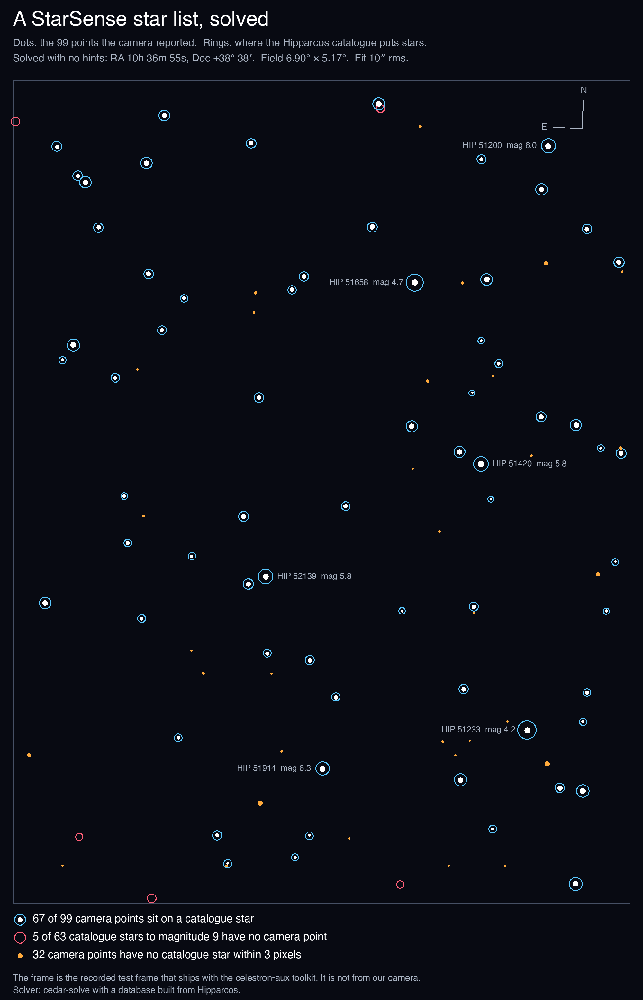

# telescope

Software for a Celestron NexStar Evolution 8 HD with StarSense AutoAlign. So
far: a small Python client for the mount's AUX bus over its WiFi, which can
also take exposures with the StarSense camera, read back its star lists and
plate solve them.

This is not Celestron's software and has nothing to do with Celestron. What it
knows about the protocol comes from the open-source projects listed under
Sources and from what one mount answered.

## What works

Everything here was tried on one NexStar Evolution (model `0x1687`), over its
WiFi, joined to a home network. Another mount may answer differently.

- 2026-11-21: which devices answer, firmware versions, axis positions,
  battery; a slow goto of one axis and back.
- 2026-11-22: the original StarSense AutoAlign camera (`0xB4`): version,
  status, stored centre, exposures, and star lists. About one list in six
  arrived a byte short over WiFi; the same list can be fetched again, and the
  client does that.
- 2026-11-22: plate solving a star list with cedar-solve. One recorded list,
  from someone else's camera, solved to a place the catalogue confirms
  ([`docs/plate-solving.md`](docs/plate-solving.md)).

Not done yet: solving a list from our camera, alignment, tracking.

## Try it

Needs [uv](https://docs.astral.sh/uv/). From `control/`:

    uv run python -m celestron_aux <mount address>              # reads only: devices, positions, battery
    uv run python -m celestron_aux <mount address> --camera     # reads only: the StarSense camera
    uv run python -m celestron_aux <mount address> --listen 60  # sends nothing: prints the bus
    uv run python -m celestron_aux <mount address> --capture --exposure 100   # one exposure and its star list
    uv run python -m celestron_aux --build-database                # once: fetch the star catalogue, build the solver's database
    uv run python -m celestron_aux <mount address> --capture --save list.json --solve   # one exposure, kept and solved
    uv run python -m celestron_aux --solve-file list.json          # solve a saved list; no connection
    uv run pytest && uv run pyright

Without an address it tries `1.2.3.4`, the mount's address on its own
hotspot. The tests run against an emulator and a stand-in for the camera;
they need no hardware and prove nothing about a real mount. The solving tests
need the database and skip without it.

## Notes

[`docs/aux-protocol.md`](docs/aux-protocol.md) is the record: what is known
about the protocol, where each fact comes from, what was measured on the real
mount and camera, and what is still unknown.

## Sources

- [indi-celestronaux](https://github.com/indilib/indi-3rdparty/tree/master/indi-celestronaux):
  INDI's driver for this protocol. Packet format, addresses and motor commands.
- [caux-simulator](https://github.com/jochym/caux-simulator): the emulator the
  tests run against.
- [celestron-aux](https://github.com/platini2/celestron-aux): a
  reverse-engineered catalogue of AUX devices and commands. Everything here
  about the StarSense camera started from its notes and recordings. The star
  list the solver tests use is from its tests (GPL-3.0).
- [cedar-solve](https://github.com/smroid/cedar-solve): the plate solver, a
  fork of ESA's [tetra3](https://github.com/esa/tetra3). Apache-2.0.
- [Hipparcos main catalogue](https://cdsarc.cds.unistra.fr/viz-bin/cat/I/239)
  (CDS I/239): the stars the solver's database is built from, fetched from
  VizieR's Harvard mirror.

## Licence

GPL-3.0. See [`LICENSE`](LICENSE).
